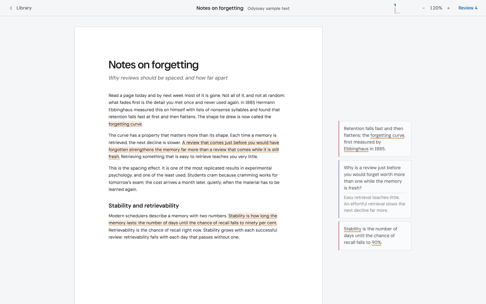
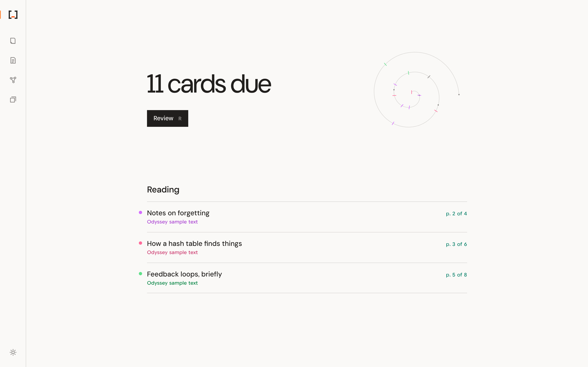
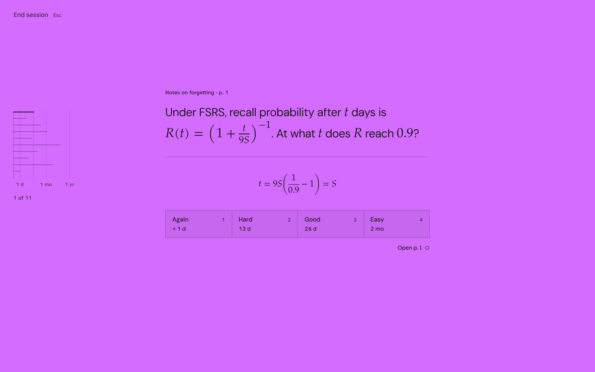

# Odyssey

[](https://github.com/specbug/odyssey/actions/workflows/ci.yml)
[](LICENSE)

**A PDF reader with a long memory.**

Odyssey is a self-hosted PDF reader where every note you make becomes a
spaced-repetition card. You read in the browser, select a passage, and write
a cloze, a question, or a plain note in the margin. Odyssey schedules each
card with [FSRS](https://github.com/open-spaced-repetition)
and brings it back just before you would forget it.



## Features

- **Notes are cards.** A note made while reading goes straight into the review
  queue. There is no separate authoring step.
- **Cloze with `[[double brackets]]`.** Each blank is its own card, graded on
  its own schedule. Review hides one blank at a time.
- **FSRS scheduling.** Each card carries its own stability and difficulty, and
  the review screen shows the interval each grade would set.
- **Back to the source.** From any card, one key opens the page it came from.
- **LaTeX and images** render inline in notes and cards.
- **Related notes** (optional). A background worker links notes that are
  genuinely related and draws them as a graph.
- **Self-hosted.** One FastAPI server with a SQLite database. PDFs, notes and
  review history stay on your machine.

There is a web app and a native macOS app. Both talk to the same server.

| Home | Review |
| --- | --- |
|  |  |

## Getting started

You need Docker or Podman with Compose.

```bash
git clone https://github.com/specbug/odyssey.git
cd odyssey
docker compose up -d --build api web    # or: podman compose up -d --build api web
```

Open <http://localhost:3000>. The API listens on <http://localhost:8000>,
with interactive docs at <http://localhost:8000/docs>. Data lives in the
`odyssey-data` volume.

The compose file also defines a `cloudflared` service for publishing the app
through a Cloudflare Tunnel. Leave it out, as above, unless you have a tunnel.
Settings live in `.env`; copy [`.env.example`](.env.example) to start.

### macOS app

Requires macOS 14 and Swift 5.9 or later. With the server running:

```bash
cd apps/mac/OdysseyMacApp
swift run OdysseyMacApp
```

### Local development

Run the API and the web app without containers:

```bash
# API: Python 3.11
cd apps/api
python3.11 -m venv .venv && source .venv/bin/activate
pip install -r requirements-dev.txt
python run.py                  # http://localhost:8000

# Web app: bun
cd apps/webapp
bun install
bun run start                  # http://localhost:3000/odyssey
```

See [CONTRIBUTING.md](CONTRIBUTING.md) for tests and conventions.

## Optional: metadata and note links

Two features call the [Meta Model API](https://dev.meta.ai) and are off
unless you set `META_API_KEY` in `.env`:

- **Metadata.** On upload, the server sends the text of the first ten pages
  of a PDF to the API to extract its title, author and a short excerpt.
- **Note links.** A background worker sends note text to the API to find
  notes that are related. Set `LINKER_ENABLED=false` to keep metadata and
  turn this off.

The default model, `muse-spark-1.3-contributor`, is on Meta's Contributor
tier: Meta may train on what is sent. Set `META_MODEL=muse-spark-1.3` for the
Standard tier, which it does not train on. Without a key, nothing leaves your
machine.

## Repository layout

| Path | What it is |
| --- | --- |
| [`apps/api`](apps/api) | FastAPI server: files, notes, FSRS scheduling, review queue, note linker |
| [`apps/webapp`](apps/webapp) | React web app. Its design rules are in [`DESIGN.md`](apps/webapp/DESIGN.md) |
| [`apps/mac`](apps/mac) | SwiftUI macOS app |
| [`packages/ui-foundation`](packages/ui-foundation) | Design tokens for the macOS app |
| [`docs`](docs) | Screenshots and archived design notes |

## Contributing

Bug reports, fixes and ideas are welcome. Read
[CONTRIBUTING.md](CONTRIBUTING.md) before opening a pull request, and follow
the [code of conduct](CODE_OF_CONDUCT.md). To report a security issue, see
[SECURITY.md](SECURITY.md).

## Acknowledgements

Odyssey borrows from Andy Matuschak's [Orbit](https://github.com/andymatuschak/orbit)
and his work on the mnemonic medium. Scheduling uses the
[FSRS](https://github.com/open-spaced-repetition) algorithm by the
open-spaced-repetition project.

## License

Odyssey is licensed under the [Apache License 2.0](LICENSE). Bundled fonts
are under the SIL Open Font License 1.1; see
[`apps/webapp/src/fonts`](apps/webapp/src/fonts/README.md).
